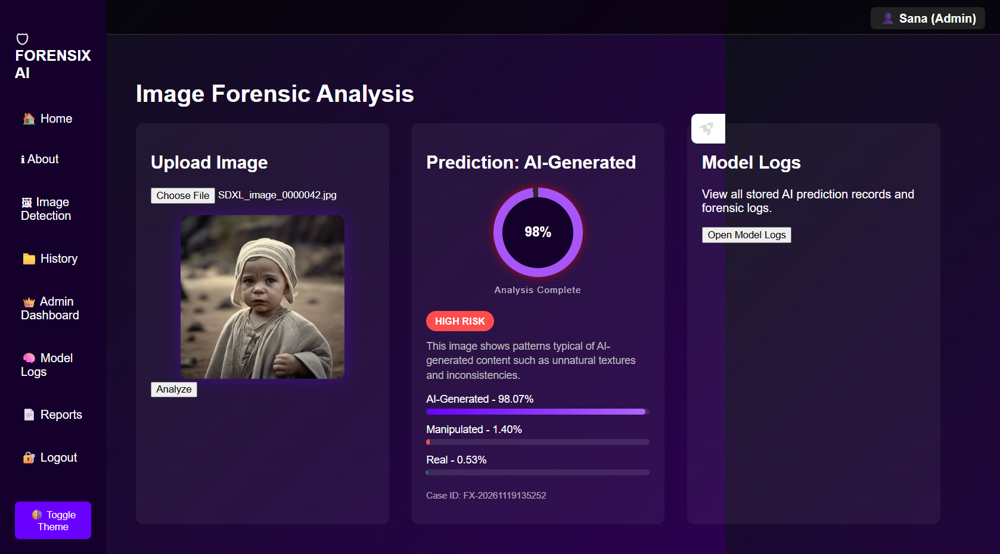
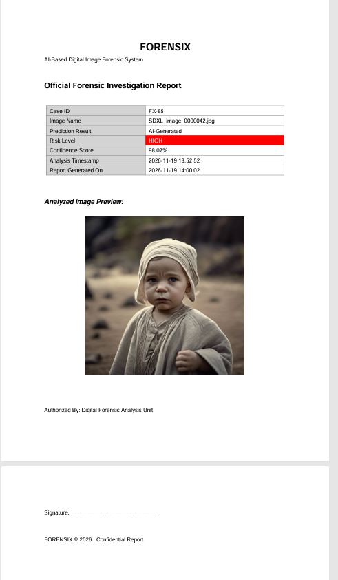
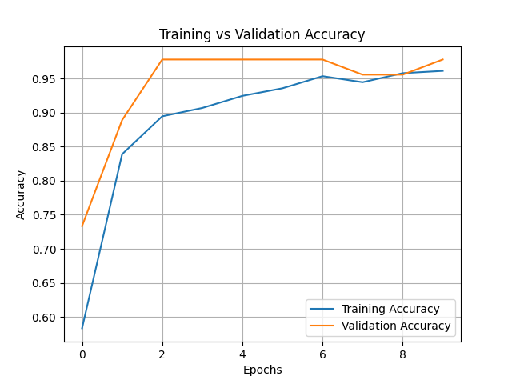
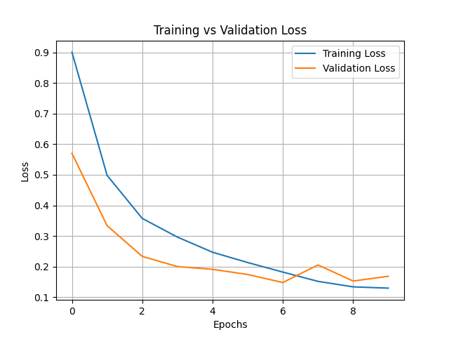
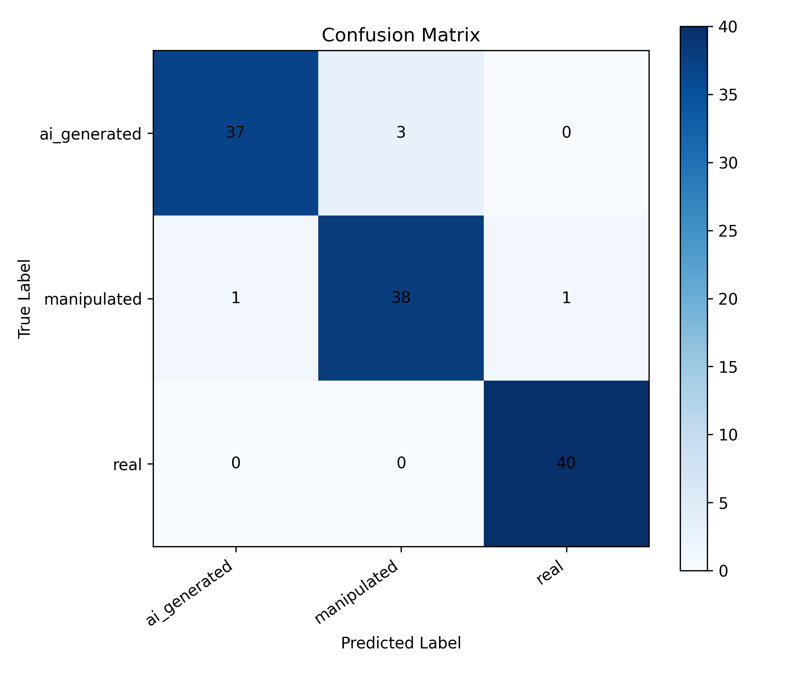

# Hybrid Deep Learning and Multimodal Forensic Feature Fusion for Detecting Real, AI-Generated, and Digitally Manipulated Images

**FORENSIX AI** is an AI-powered image forensics application developed as an MCA academic project.

**Project Type:** MCA Academic Project  
**Primary Focus:** Deep Learning | Image Forensics | CNN | Flask Web Application

---

## About the Project

The rapid growth of generative AI and digital image editing has made it increasingly difficult to distinguish authentic images from artificially generated or digitally manipulated ones.

FORENSIX AI explores a deep learning-based approach to image forensics using a Convolutional Neural Network (CNN).

The primary image classification system identifies three categories:

- **Real:** Images classified as authentic.
- **AI-Generated:** Images classified as AI-generated.
- **Manipulated:** Images classified as digitally altered.

The trained model is integrated into a Flask-based web application that provides an interactive interface for image prediction and result visualization.

## Key Features

- Three-class image classification.
- CNN-based image analysis.
- Interactive Flask web application.
- Image prediction with confidence scores.
- Prediction history and report generation.
- User authentication and admin dashboard.
- SQLite database integration.
- Experimental video deepfake detection prototype.

## Application Preview

### 1. Homepage

### 2. Image Detection Result

### 3. Dashboard

### 4. Generated Forensic Report

## Live Demonstration

**Live Demo:** Coming soon.

## Technologies Used

| Category | Technologies |
|---|---|
| Programming Language | Python |
| Deep Learning | TensorFlow, Keras |
| Image Classification | Convolutional Neural Network |
| Web Framework | Flask |
| Image Processing | OpenCV, Pillow |
| Frontend | HTML, CSS, JavaScript |
| Database | SQLite |
| Data Analysis | NumPy, Matplotlib, Scikit-learn |
| Experimental Video Module | PyTorch |

## Model Training Results

### Accuracy Plot

### Loss Plot

These plots illustrate training and validation progress. They do not independently establish performance on external images.

## Model Evaluation

The image classification model was evaluated using a held-out test dataset containing **120 images**, with 40 images per class.

### Test Accuracy

**95.83% (approximately 96%)**

The model correctly classified 115 out of 120 test images.

### Classification Report

| Class | Precision | Recall | F1-score | Test Images |
|---|---:|---:|---:|---:|
| AI-Generated | 0.97 | 0.93 | 0.95 | 40 |
| Manipulated | 0.93 | 0.95 | 0.94 | 40 |
| Real | 0.98 | 1.00 | 0.99 | 40 |

### Confusion Matrix

Detailed metrics are available in `evaluation/classification_report.txt`.

**Evaluation note:** These results describe performance on the project's held-out test dataset. They do not establish equivalent accuracy on arbitrary external images or images from different sources and distributions. External-image generalisation has not been independently validated.

The trained model weights and original dataset are not included in this public repository.

## Experimental Video Detection

The project also contains an experimental video deepfake detection prototype involving frame extraction and deep learning techniques.

**Important:** Video detection is experimental and has not been validated for reliable performance. It is not part of the verified image classification results. The primary focus remains image forensics.

## Project Limitations

- Image classification performance is reported on the project's held-out test dataset.
- Generalisation to arbitrary external images has not been independently established.
- Predictions should not be treated as definitive proof of image authenticity.
- Video detection remains experimental and unvalidated.
- Model performance may vary depending on input image characteristics and data distribution.

## Project Purpose

This project demonstrates the practical application of deep learning, image classification, digital image forensics and web application development to explore digital image authenticity.

---

**Developed as part of an MCA academic project.**
